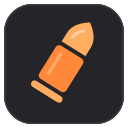

<p align="center">
  
</p>

<p align="center">
  <strong>Windows · NVIDIA NVENC · Local MP4 &amp; PNG · MIT licensed</strong>
</p>

<p align="center">
  <a href="#why-gavnel">The idea</a> ·
  <a href="#how-it-compares">Comparison</a> ·
  <a href="#start-clipping">Get started</a> ·
  <a href="docs/usage.md">User guide</a> ·
  <a href="docs/development.md">Build &amp; contribute</a>
</p>

---

## Why Gavnel?

**A clipping app should help you keep a moment and get back to your game.**

Gavnel is a local gameplay recorder for people who want their clips on their own PC. Press a key to save what just happened, record a whole session, and find it later in a simple library. Recordings are ordinary files in a folder you choose.

The vision is straightforward: **quick startup, dependable capture, and a small footprint.** No ads, subscription prompts, account setup, social feed, or cloud upload workflow. Recording and playback work locally without an internet connection; sharing is something you do with your files, on your terms.

Gavnel is in active development. Its narrow scope is deliberate: make the local recording experience feel good before expanding it.

## Play. Clip. Keep.

1. **Play** — choose a game, window, or monitor and turn capture on.
2. **Clip** — press **F8** to save the recent action; the default replay length is 60 seconds.
3. **Keep** — review the MP4 in your library, open its folder, or use it in your favorite editor.

### Already in Gavnel

- **Replay clips and long recordings.** Save recent gameplay, start a recording yourself, or automatically record supported game sessions.
- **A library that stays on your PC.** Thumbnails, game/source folders, search, sorting, and built-in video playback.
- **Bookmarks and screenshots.** Mark moments in long recordings and save full-resolution PNGs.
- **Audio you control.** PC audio, microphone input, optional separate tracks, push to talk, and local noise suppression.
- **Preferences that stick.** Your source, recording settings, save folder, hotkeys, library view, and capture on/off state survive normal restarts.
- **GPU video encoding.** A native Rust/egui interface, NVIDIA NVENC, and background file saving. No separate FFmpeg installation or Overwolf client.

## How it compares

Medal and Outplayed are useful for people who want sharing tools, editors, or automatic event highlights. Gavnel's focus is a smaller, self-contained local recorder.

**All three can save recordings locally.** The difference is what comes with that recording experience.

| What matters | Gavnel — current app & direction | Medal | Outplayed |
| :--- | :--- | :--- | :--- |
| Core focus | Local capture, playback, and files you control | Recording with sharing, profiles, and cloud options [↗][medal-plans] | Game capture, event highlights, editing, and sharing [↗][outplayed-guide] |
| Local recordings | MP4 / PNG in your chosen folder | Saves local clips [↗][medal-local] | Saves local recordings [↗][outplayed-local] |
| Ads | None | Free tier includes ads; Premium removes them [↗][medal-plans] | Includes ads; Premium removes them [↗][outplayed-plans] |
| Paid tiers | No paid tier; MIT-licensed source | Free and Premium tiers [↗][medal-plans] | Free Core and paid Premium plans [↗][outplayed-plans] |
| Cloud & sharing | No upload service; share your files yourself | Optional uploads and Medal Cloud features [↗][medal-plans] | Optional Outplayed.tv hosting and sharing [↗][outplayed-plans] |
| Extra platform | Native Windows app; no recording account | Account features for profiles, sharing, and cloud [↗][medal-plans] | Runs on the Overwolf client; app access requires login, though recording continues while logged out [↗][outplayed-app] [↗][outplayed-plans] |
| Performance approach | Native UI, NVENC, bounded replay data, background exports | GPU or CPU encoding options [↗][medal-performance] | Hardware or CPU encoding options [↗][overwolf-codecs] |

<details>
<summary><strong>Sources, performance context, and comparison scope</strong></summary>

Comparison checked **November 9, 2026**, using the vendors' official documentation. Plans and features can change. Gavnel's column describes this repository's implementation and stated direction, rather than a promise of future features.

Medal documents [slow interface/editor cases][medal-ui] and [choppy-recording troubleshooting][medal-performance]. Overwolf documents [capture performance issues][outplayed-performance] too. These describe problems that can occur; they do not establish that either app is always slow.

Fast startup and low recording overhead are Gavnel's goals. **There is no side-by-side startup, FPS, or memory benchmark here.** Both alternatives also support hardware encoding. Actual results depend on the game, hardware, driver, recording settings, and storage.

Gavnel currently has a narrower feature set: Windows with an NVIDIA GPU, a small built-in game-profile list, and no automatic kill/death highlight detection, cloud sync, or built-in montage editor.

</details>

## Start clipping

**Current target: Windows 11 x64, an SDR display, and an NVIDIA GPU with NVENC support.** AMD/Intel encoding and HDR capture are not supported in this build.

### Running from this repository

Install stable Rust for Windows MSVC, Visual Studio C++ Build Tools, and the Windows SDK. Then, from the repository folder:

```powershell
powershell -NoProfile -ExecutionPolicy Bypass -File scripts/launch.ps1
```

The launcher builds the current source and opens Gavnel. The first build can take a while; later builds are incremental. To add desktop and Start menu shortcuts that use this same launcher:

```powershell
powershell -NoProfile -ExecutionPolicy Bypass -File scripts/install-launcher.ps1
```

In Gavnel, choose your capture source, check your save folder under **Settings → Storage**, and turn capture **ON**. Start your game and press your clip key when something worth keeping happens.

### Default shortcuts

- **F8** — save a replay clip; add a bookmark during a long recording.
- **Alt + F7** — start or stop a long recording.
- **F4** — add a bookmark to a long recording.
- **F7** — save a screenshot.

All shortcuts are customizable. Existing preferences can differ from these defaults.

## A few useful details

- Defaults: **1080p · 60 FPS · 20 Mbps · 60-second replay**. PC audio is on; the microphone is off.
- Capture one source at a time. Game/window capture turns black when the target loses focus while audio continues; monitor capture includes everything visible on that display.
- Replay retention has a **512 MiB compressed-packet budget**. This is not a cap on total app RAM or GPU memory. Long recordings stream to disk.
- **Exit** finishes pending saves. Closing to the tray is optional and keeps capture running. A crash or power loss can leave an unfinished recording.
- Local files need your own backups. Gavnel does not upload them to a recovery service.

Read the [user guide](docs/usage.md) for recording modes, audio, storage, and playback. See [development & diagnostics](docs/development.md) for build instructions and the [software quality guide](docs/software-quality.md) before contributing.

---

<p align="center">
  <br>
  <strong>Your game. Your moments. Your files.</strong><br>
  <a href="LICENSE">MIT License</a> · <a href="THIRD_PARTY_NOTICES.md">Third-party notices</a>
</p>

[medal-plans]: https://support.medal.tv/support/solutions/articles/48001218475-medal-premium-faq
[medal-local]: https://support.medal.tv/support/solutions/articles/48001227747
[medal-performance]: https://support.medal.tv/support/solutions/articles/48000922094
[medal-ui]: https://support.medal.tv/support/solutions/articles/48001242234-nvidia-issues-with-desktop-app-editor-ui-blurry-slow-
[outplayed-app]: https://www.overwolf.com/app/overwolf-outplayed
[outplayed-plans]: https://support.overwolf.com/support/solutions/articles/9000284652-outplayed-account-plans
[outplayed-guide]: https://support.overwolf.com/support/solutions/articles/9000284663-outplayed-quick-set-up-guide
[outplayed-local]: https://support.overwolf.com/support/solutions/articles/9000284626-outplayed-faq
[outplayed-performance]: https://support.overwolf.com/support/solutions/articles/9000181387-common-capture-issues
[overwolf-codecs]: https://support.overwolf.com/support/solutions/articles/9000177861-video-codec-selection-and-availability
