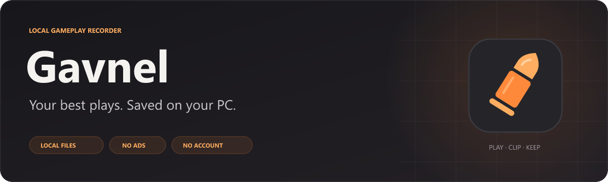
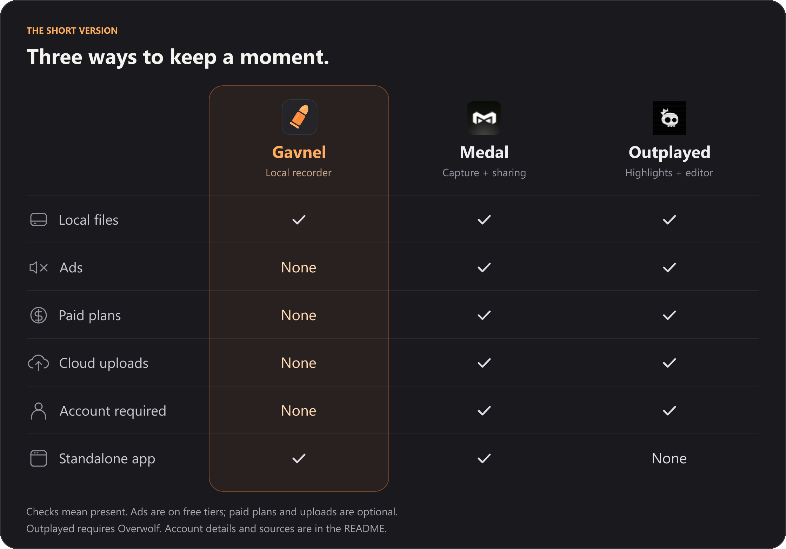

<p align="center">
  
</p>

## Why choose Gavnel?

**Your clips stay on your PC. No ads. No account. No subscription.**

<p align="center">
  
</p>

[Comparison notes & sources](docs/comparison.md)

## Install

**Windows 10 22H2 / Windows 11 x64 · NVIDIA GPU with NVENC · SDR display**

Windows 10 supports PC audio and microphone capture. Game-only and selected-app audio require Windows 11. Windows 10 recording validation is pending; see [compatibility checks](docs/development.md#windows-compatibility-checks).

1. [**Download the Windows installer**](https://github.com/Nuqb/gavnel/releases/latest) (`Gavnel-Setup-VERSION-x64.exe`).
2. Open it and follow setup.
3. Turn capture **ON**. Press **F8** to save the last **60 seconds**.

[User guide](docs/usage.md)

---

## Development

Native **Rust / egui** desktop app, Windows capture, and **NVIDIA NVENC** recording. The editor uses Windows Media Foundation for previews, audio mixing, and H.264/AAC exports. Recordings and preferences use local files; there is no application server or external editing-tool installation.

### Build & run

Install stable Rust for Windows MSVC, Visual Studio C++ Build Tools, and the Windows SDK. From the repository folder:

```powershell
powershell -NoProfile -ExecutionPolicy Bypass -File scripts/launch.ps1
```

The launcher builds current source and opens a versioned executable. Later builds are incremental. If an older build is running, it requests a normal exit so recordings can finish saving.

To create desktop and Start menu shortcuts that use the same launcher:

```powershell
powershell -NoProfile -ExecutionPolicy Bypass -File scripts/install-launcher.ps1
```

Keep local shortcuts pointed at the launcher; do not replace them with direct executable links or manually copy binaries to `dist`.

### Checks & contribution

Read the [contributor guide](CONTRIBUTING.md) before making changes.

```powershell
cargo fmt
powershell -NoProfile -ExecutionPolicy Bypass -File scripts/check.ps1
powershell -NoProfile -ExecutionPolicy Bypass -File scripts/launch.ps1 -BuildOnly
```

Replay retention has a **512 MiB compressed-packet budget**, not a cap on total RAM or GPU memory. Long recordings stream to disk. Startup speed and recording overhead are goals; no comparative performance benchmark is published here.

- [Development & diagnostics](docs/development.md) — source map, onboarding previews, and recording diagnostics.
- [Release command and recovery](docs/releases.md)
- [Game detection](docs/game-detection.md)
- [Localization](docs/localization.md)

## License

Gavnel is [source-available and free to use](LICENSE), including for monetized videos and streams. Private builds and modifications for your own use are allowed. Redistribution, resale, rebranding, and reuse of Gavnel code or original assets in other products require prior written permission. These restrictions do not apply to your recordings or screenshots.

Earlier MIT-licensed code and releases, including v0.3.4 and earlier release tags, retain their original permissions; see [the historical MIT license](HISTORICAL-MIT.txt). [Third-party components](THIRD_PARTY_NOTICES.md) retain their own licenses. Public GitHub viewing and forking remain subject to GitHub's terms. See the full [license](LICENSE) for scope and exceptions.
